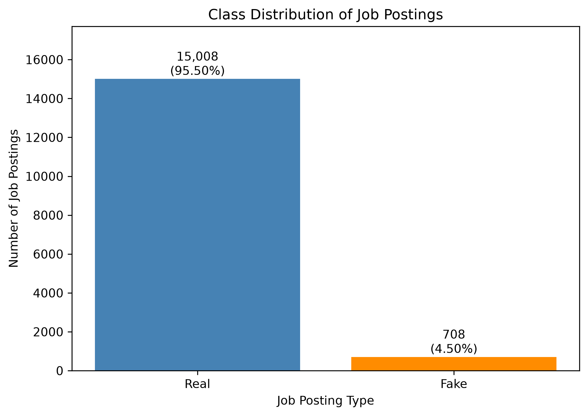
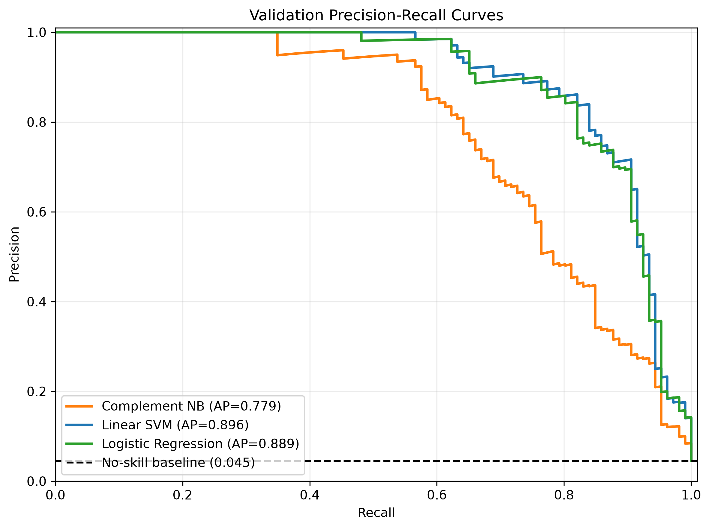
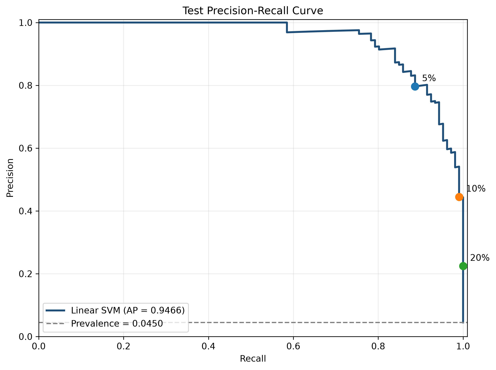
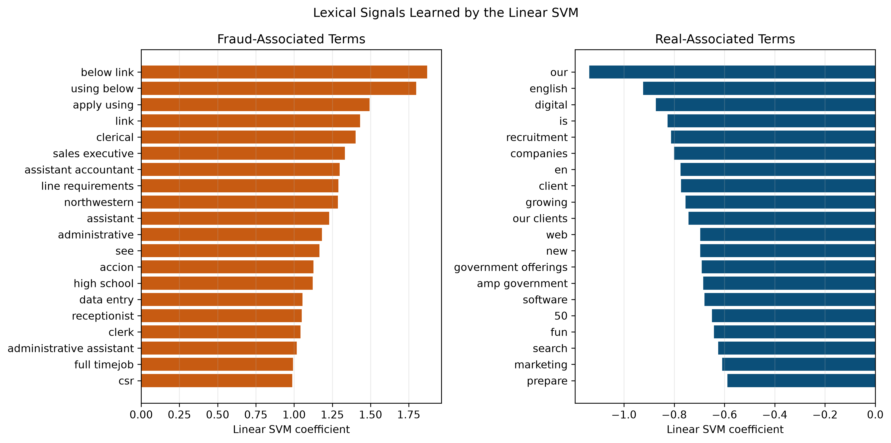

# Alert-Budgeted Detection of Fraudulent Job Postings

## 项目原理与应用学习指南

Group 17

Wang Yule · SUN Shiyan · Wang Zixu

本指南用于理解项目的业务逻辑、算法原理、实验设计和实际应用方式。

---PAGEBREAK---

## 目录

1. 一句话理解项目
2. 业务问题如何转化为机器学习问题
3. 数据来源与标签
4. 为什么数据泄漏是核心风险
5. TF-IDF 文本表示
6. 三个候选模型
7. 训练、调参和模型选择
8. 为什么使用 PR-AUC
9. 固定人工审核预算
10. 置信区间与统计不确定性
11. 本项目的主要结果
12. 错误分析与可解释性
13. 实际应用方案
14. 工程复现方法
15. 局限性与改进方向
16. 学习总结与常见问答

## 1. 一句话理解项目

这个项目不是要求模型“自动判定一条招聘广告是否违法”，而是让模型对招聘广告进行风险排序，使人工审核团队能够在有限时间内优先检查最可疑的广告。

因此，项目同时包含两个层面：

- **机器学习层面**：从职位文本中学习虚假招聘与正常招聘的差异。
- **业务决策层面**：把模型分数转化为固定数量的审核名单，并分析需要付出多少误报成本。

这种问题设定比单纯追求准确率更接近真实平台的工作方式。

## 2. 业务问题如何转化为机器学习问题

招聘平台每天会产生大量广告，人工无法逐条仔细审核。一个可执行的流程是：

1. 模型读取招聘广告文本。
2. 为每条广告生成一个连续风险分数。
3. 按分数从高到低排序。
4. 人工只审核排名最靠前的一部分广告。
5. 审核人员结合公司、链接、联系方式等信息作最终判断。

形式化地，每条广告是一个文本样本 x，标签 y = 1 表示虚假招聘，y = 0 表示正常招聘。

模型需要学习 P(y = 1 | x)，或者一个与风险单调相关的排序分数 s(x)。本项目更关注分数排序是否正确，而不是把分数直接解释成概率。

## 3. 数据来源与标签

项目使用 Employment Scam Aegean Dataset，简称 EMSCAD。原始数据包含 17,880 条英文招聘广告，其中 17,014 条为正常招聘，866 条为虚假招聘。

主要文本字段包括：

- 职位标题 `title`
- 公司介绍 `company_profile`
- 职位描述 `description`
- 职位要求 `requirements`
- 福利信息 `benefits`

这些字段被连接为 `text_all`。这样可以保留标题中的岗位类型信息，也保留正文中的申请方式、薪资、联系方式等线索。

标签由招聘平台的专业人员进行人工判断，因此它表示“数据集中被标注为虚假招聘”，而不是法律意义上的最终裁定。

## 4. 为什么数据泄漏是核心风险

数据泄漏是指模型在训练或评价时使用了现实中无法获得的信息。招聘欺诈项目中最常见的问题是重复广告。

同一个模板可能被发布到多个城市，只有 URL 哈希或少量格式字符不同。如果把其中一个版本放入训练集，另一个版本放入测试集，模型会记住几乎相同的文本，测试结果就会偏乐观。

本项目采用两级处理：

- 删除 `text_all` 和标签完全相同的记录。
- 将文本转成规范化键，去掉 URL 哈希、标点和格式差异，再删除近似重复记录。

最终从原始 17,880 条记录得到 15,716 条数据：

| 项目 | 数量 |
|---|---:|
| 原始记录 | 17,880 |
| 完全重复删除 | 2,001 |
| 规范化重复删除 | 163 |
| 最终记录 | 15,716 |
| 正常招聘 | 15,008 |
| 虚假招聘 | 708 |

数据按 70%/15%/15% 分层划分为训练集、验证集和测试集，并使用固定随机种子 42。训练、验证、测试之间没有共享的 `job_id` 或规范化文本键。



## 5. TF-IDF 文本表示

模型不能直接处理自然语言，需要把文本转换为数值向量。TF-IDF 是经典且可解释的文本表示方法。

词频 TF 表示某个词在文档中出现的频繁程度。逆文档频率 IDF 表示一个词在整个语料中有多罕见：

IDF(t) = log((1 + N) / (1 + df(t))) + 1

TF-IDF(t, d) = TF(t, d) × IDF(t)

其中 N 是文档数量，df(t) 是包含词 t 的文档数量。

直觉是：一个词在当前广告中经常出现，但在所有广告中较少出现，它对区分该广告更有价值。“apply”“job”等词处处出现，权重较低；“below link”“data entry”等组合可能更有区分度。

项目使用：

- 一元词和二元词，例如 `data`、`entry`、`data entry`
- 最多 60,000 个特征
- `min_df=3`，过滤极少出现词
- `max_df=0.95`，过滤几乎所有文档都有的词
- 次线性 TF 缩放，避免一个词重复很多次后权重失控

TF-IDF 必须在每个训练折内部拟合。若先用全部数据拟合词表，再交叉验证，就会让训练折间接看到验证折词汇。

## 6. 三个候选模型

### 6.1 Logistic Regression

逻辑回归使用线性组合表示对数几率：

log(p / (1 − p)) = wᵀx + b

p(y = 1 | x) = 1 / (1 + exp(−(wᵀx + b)))

它适合高维稀疏文本，训练快，系数可以解释。项目使用 `class_weight="balanced"` 提高少数类权重。

### 6.2 Linear SVM

线性支持向量机寻找一个分离正负样本且间隔较大的超平面：

目标函数 = min [ (1/2) × ||w||² + C × Σ max(0, 1 − yᵢ(wᵀxᵢ + b)) ]

C 越大，模型越重视训练误差；C 越小，正则化越强。SVM 输出的是到决策边界的距离，适合排序，但不是概率。

本项目最终选择 Linear SVM，参数为 `C=1.0`，并使用平衡类别权重。

### 6.3 Complement Naive Bayes

Complement Naive Bayes 适合不平衡文本分类。它从“不属于某个类别的数据”估计特征分布，对文本词频较稳健，缺点是特征之间独立假设较强，且通常排序能力不如线性 SVM。

## 7. 训练、调参和模型选择

每个模型只在训练集上进行三折分层交叉验证。分层保证每折中的欺诈比例接近总体比例。

参数搜索范围控制得较小：

- Logistic Regression：`C = 0.1, 1, 10`
- Linear SVM：`C = 0.01, 0.1, 1`
- Complement NB：`alpha = 0.1, 1`

交叉验证用于选择每个模型族内部的最佳参数。随后，每个模型在完整训练集上重新拟合，并在验证集上比较。

模型选择只看验证集 PR-AUC。测试集在模型固定后才生成一次预测，避免根据测试结果反复调整模型。

## 8. 为什么使用 PR-AUC

虚假招聘只占约 4.5%。如果模型把所有广告都预测为正常，准确率仍有约 95.5%，但一个虚假招聘都抓不到。

Precision 和 Recall 定义为：

Precision = TP / (TP + FP)

Recall = TP / (TP + FN)

PR 曲线展示不同排序阈值下 Precision 与 Recall 的权衡。PR-AUC，或 Average Precision，是正类排序质量的核心指标。类别不平衡时，ROC-AUC 可能显得很高，PR-AUC 更能反映少数类检测是否有效。



## 9. 固定人工审核预算

真实审核团队每天只能检查固定数量的广告。因此项目不使用任意概率阈值，而是使用 top-k 规则：

1. 按模型分数从高到低排序。
2. 取前 5%、10% 或 20% 的广告。
3. 计算这些广告中发现了多少虚假招聘。

这相当于把模型输出转化为运营决策：

| 审核比例 | 审核数量 | 找到欺诈 | Precision | Recall |
|---|---:|---:|---:|---:|
| 5% | 118 | 94 | 79.7% | 88.7% |
| 10% | 236 | 105 | 44.5% | 99.1% |
| 20% | 472 | 106 | 22.6% | 100% |

5% 审核预算精度高，但会漏掉 12 个欺诈案例。扩大到 10% 几乎抓住全部欺诈，但误报数量显著增加。因此最优预算取决于审核人员数量和误报成本。



## 10. 置信区间与统计不确定性

测试集只有 106 个正类，单次测试指标存在抽样波动。Bootstrap 方法从测试集中有放回抽样，重复计算指标：

1. 从测试集随机抽取与原始测试集同样数量的样本。
2. 计算一次 PR-AUC。
3. 重复 2,000 次。
4. 取第 2.5 和第 97.5 百分位数作为 95% 区间。

本项目测试 PR-AUC 为 0.9466，95% 区间为 0.9154–0.9713。验证集 PR-AUC 为 0.8960，区间为 0.8471–0.9405，两者区间重叠，因此不能声称测试集表现显著更好。

## 11. 本项目的主要结果

| 模型 | 验证 PR-AUC | 验证 ROC-AUC |
|---|---:|---:|
| Linear SVM | 0.8960 | 0.9852 |
| Logistic Regression | 0.8893 | 0.9847 |
| Complement Naive Bayes | 0.7788 | 0.9649 |
| 无技能基线 | 0.0450 | 0.5000 |

最终模型选择 Linear SVM。测试集 PR-AUC 为 0.9466，ROC-AUC 为 0.9966。

TF-IDF 消融显示，一元词加二元词的验证 PR-AUC 为 0.8960，而仅一元词为 0.8822。二元词提升不大但稳定，说明短语信息有帮助。

## 12. 错误分析与可解释性

在 5% 审核预算下，测试集有 24 个误报和 12 个漏报。

主要误报类型：

- clerical、data-entry、receptionist 等行政岗位
- insurance sales、customer service 等销售/客服岗位
- 部分技术或法律岗位

这些广告可能使用“below link”“apply using”等与诈骗模板类似的词，因此被模型误判。

漏报通常是短文本。漏报中位长度为 90 词，而真正欺诈样本的中位长度为 243 词。短广告提供的信息太少，模型难以判断。

Linear SVM 权重最大的欺诈相关特征包括：

- below link
- using below
- apply using
- clerical
- data entry

这些系数表示“在该数据集中有区分能力”，不代表这些词本身导致欺诈。模型学到的是数据集中的词面相关性，不是法律证据。



## 13. 实际应用方案

建议的生产流程是：

1. 自动提取职位文本、公司元信息、外部链接和发布时间。
2. 模型为每条广告生成排序分数。
3. 审核系统显示前 5% 高风险广告。
4. 人工审查公司资质、申请链接、联系方式和薪资描述。
5. 人工作最终决定。
6. 审核结果进入反馈库，用于后续模型更新。
7. 监控数据漂移、误报率、漏报率和不同岗位类别的表现。

应用时必须遵守以下原则：

- 不自动拒绝岗位，不把分数当作定罪依据。
- 保留人工复核和申诉渠道。
- 不把模型输出解释为概率，除非另行完成概率校准。
- 定期用最新平台数据重新验证阈值。
- 对岗位类型、地区、语言等群体分别检查误报率。

## 14. 工程复现方法

仓库包含三个可复现阶段：

```text
data/                 原始、中间和最终数据
01_data_preparation/  数据清洗、EDA、基线
02_modelling/         TF-IDF、模型训练、消融、置信区间
03_evaluation/        测试评价、审核预算、错误案例、特征解释
```

完整的模型和数据结果可通过以下命令重新生成：

```bash
bash run_all.sh
```

主要文件：

- `02_modelling/models/selected_model.joblib`：保存的完整 TF-IDF + Linear SVM pipeline
- `02_modelling/predictions/selected_model_predictions.csv`：验证集和测试集排序分数
- `02_modelling/reports/model_comparison.csv`：三个模型的验证比较
- `03_evaluation/outputs/test_metrics.json`：测试集最终指标
- `03_evaluation/outputs/test_error_cases.csv`：5% 审核预算下的全部误报和漏报

## 15. 局限性与改进方向

当前模型的主要局限包括：

- TF-IDF 只捕捉词面特征，无法理解完整语义和复杂改写。
- EMSCAD 是 2012–2014 年的历史英文数据，不能直接代表当前平台。
- 标签可能包含人工标注误差。
- Linear SVM 分数未经概率校准。
- 审核预算只使用一个测试集估计，真实场景仍需持续监测。

可能的改进方向：

- 使用 Sentence Transformer 或领域预训练模型提取语义特征。
- 将职位文本与公司历史、域名、申请链接等结构化信息结合。
- 在验证集上做概率校准。
- 使用时间外验证和平台级交叉验证。
- 加入公平性、漂移检测和主动学习机制。

## 16. 学习总结与常见问答

**问题：为什么不直接使用准确率？**

因为欺诈样本很少。预测全部正常也会得到约 95.5% 的准确率，但没有任何实际价值。

**问题：为什么使用 PR-AUC？**

PR-AUC 关注少数正类的排序质量，适合欺诈检测这种高度不平衡任务。

**问题：为什么选 Linear SVM？**

它在验证集上取得最高 PR-AUC，模型复杂度适中，文本特征系数也较容易解释。

**问题：SVM 分数能否当作概率？**

不能。分数是决策函数值，只适合比较风险高低；概率输出需要额外校准。

**问题：如何决定审核 5% 还是 10%？**

取决于审核人员容量和误报成本。5% 精度高、召回较低；10% 召回接近 100%，但需要处理更多误报。

**问题：模型能否直接上线？**

不能直接用于自动拒绝。它应作为人工审核的排序工具，并先在目标平台的最新数据上重新验证。

## 参考资料

Vidros, S., Kolias, C., Kambourakis, G., and Akoglu, L. (2017). Automatic Detection of Online Recruitment Frauds: Characteristics, Methods, and a Public Dataset. Future Internet, 9(1), 6. https://doi.org/10.3390/fi9010006

Kaggle. Real / Fake Job Posting Prediction. https://www.kaggle.com/datasets/shivamb/real-or-fake-fake-jobposting-prediction
